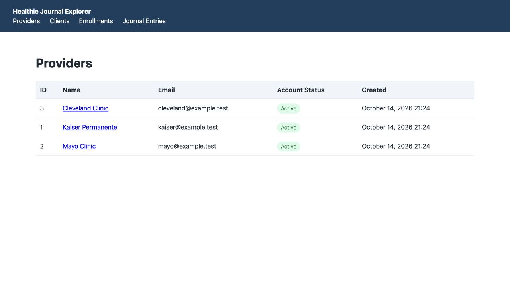

# Rails Healthie Journal

A minimal Rails foundation for Healthie full-stack engineering pairing interview
preparation. It provides ActiveRecord, PostgreSQL, Minitest, the interview's core
domain schema and query methods, a small deterministic development dataset, and a
read-only browser explorer for demonstrating the model relationships.



## Prerequisites

- Ruby 3.4.11 (recorded in `.ruby-version`; use your existing Ruby version manager).
- Bundler 2.6.9 and Rails 8.1.4 (dependencies are pinned in `Gemfile.lock`).
- A running local PostgreSQL server on `localhost:5432`; verified with PostgreSQL
  18.6. No Node.js or Docker is required.

The database configuration uses the PostgreSQL role matching your operating-system
username. That role must be able to create databases. On the existing Homebrew
setup, PostgreSQL is managed with `brew services start postgresql@18`.
Check availability with `pg_isready -h localhost`.

If your local installation uses another role, password, or port, set the standard
PostgreSQL environment variables `PGUSER`, `PGPASSWORD`, and `PGPORT` in your shell.
Do not commit secrets. Rails also supports `DATABASE_URL`; use a separate test
database when setting a URL for tests.

## Local setup

```sh
bundle install
bin/rails db:prepare
```

This creates `rails_healthie_journal_development` and
`rails_healthie_journal_test`. To prepare only the test environment explicitly:

```sh
RAILS_ENV=test bin/rails db:prepare
```

Check ActiveRecord connectivity:

```sh
bin/rails runner 'puts ActiveRecord::Base.connection.adapter_name'
```

The expected output is `PostgreSQL`. `bin/setup --skip-server` is also available
as the conventional Rails setup helper.

## Development commands

```sh
bin/rails server
bin/rails console
bin/rails test
```

The server listens at `http://localhost:3000`. The read-only explorer is available
at `http://localhost:3000/`, with navigation to providers, clients, enrollments,
and journal entries. It uses server-rendered Rails views and intentionally has no
create, update, or delete actions. Verify boot using Rails' generated health route:

```sh
curl --fail http://localhost:3000/up
```

There is no application root route. `/up` checks application boot, not database
connectivity.

If port 3000 is occupied, run `bin/rails server -p 3001` and check
`http://localhost:3001/up`. The initial bootstrap was verified on port 3001.

## Seed data

Load the deterministic development dataset with:

```sh
bin/rails db:seed
```

It is safe to run the command again. Providers and clients are found by their
`@example.test` email addresses; enrollments are identified by provider, client,
and start time so historical relationships remain distinct; journal entries are
identified by client, content, and timestamp. Seeds do not delete or modify
existing application data.

The dataset contains Kaiser Permanente, Mayo Clinic, and Cleveland Clinic; five
clients; both plans; active and ended enrollments; and journal entries spanning
the relationship history. Alice Nguyen is active with both Kaiser and Mayo. Bob
Martinez has an ended Kaiser enrollment followed by a newer active enrollment.
Carol Johnson has no active providers but retains entries from before and after
her Cleveland enrollment ended. Erin Patel has an open Cleveland enrollment and
a deactivated account to demonstrate that account status is separate from
enrollment status.

## ActiveRecord query examples

After seeding, in `bin/rails console`, load the named records and use the
existing associations directly:

```ruby
kaiser = Provider.find_by!(email: "kaiser@example.test")
alice = Client.find_by!(email: "alice.nguyen@example.test")
bob = Client.find_by!(email: "bob.martinez@example.test")
carol = Client.find_by!(email: "carol.johnson@example.test")

# All current clients for a provider (active enrollment only)
kaiser.current_clients

# All current providers for a client (active enrollment only)
alice.current_providers

# A client's entries, including entries after enrollments end; newest first
carol.journal_entries.recent_first

# Entries for a provider's currently enrolled clients, newest first
kaiser.current_client_journal_entries.recent_first

# Historical enrollment queries: Bob's first Kaiser enrollment is ended and his later one is active
Enrollment.where(provider: kaiser, client: bob).order(:started_at)
Enrollment.where(provider: kaiser, client: bob).where.not(ended_at: nil)

# Carol's entries remain available despite having no current provider relationship
carol.current_providers # => []
carol.journal_entries.recent_first
```

For concise, deterministic console output without database-specific IDs, use these
projections after running the queries above:

```ruby
kaiser.current_clients.order(:name).map(&:name)
# => ["Alice Nguyen", "Bob Martinez", "Devon Lee"]

alice.current_providers.order(:name).map(&:name)
# => ["Kaiser Permanente", "Mayo Clinic"]

carol.journal_entries.recent_first.pluck(:content)
# => ["Entry written after enrollment ended.", "Entry written while enrolled."]

kaiser.current_client_journal_entries.recent_first.pluck(:content)
# => ["Energy has improved this week.", "Returning to care with a new plan.",
#     "Completed my first week of tracking.", "Started a new nutrition plan."]

Enrollment.where(provider: kaiser, client: bob).order(:started_at).map do |enrollment|
  [enrollment.plan, enrollment.started_at.iso8601, enrollment.ended_at&.iso8601]
end
# => [["basic", "2026-02-01T09:00:00Z", "2026-04-30T17:00:00Z"],
#     ["premium", "2026-06-01T09:00:00Z", nil]]

Enrollment.where(provider: kaiser, client: bob).where.not(ended_at: nil).map do |enrollment|
  [enrollment.plan, enrollment.started_at.iso8601, enrollment.ended_at.iso8601]
end
# => [["basic", "2026-02-01T09:00:00Z", "2026-04-30T17:00:00Z"]]

carol.current_providers.order(:name).map(&:name)
# => []
carol.journal_entries.recent_first.pluck(:content)
# => ["Entry written after enrollment ended.", "Entry written while enrolled."]
```

`current_clients` and `current_providers` use only enrollments where `ended_at`
is `nil`. Journal entries are client-owned, so ending an enrollment never removes
or filters the client's entries. The provider journal-entry query includes entries
for a client only while that client is currently enrolled with that provider. The
active-enrollment unique index guarantees one join row per provider/client pair,
so the query has no duplicate entries without an association-level `DISTINCT`.

## Architecture and next steps

The application uses conventional Rails controller and view support for the
read-only explorer while retaining conventional ActiveRecord structure. The small
amount of explorer CSS lives in the application layout, so it adds no JavaScript,
asset-pipeline, or frontend-package dependency. Unused mail, storage, jobs,
realtime features, and deployment tooling were skipped.

The domain includes providers, clients, enrollments, and client-owned journal
entries. Enrollments connect providers and clients with a `basic` or `premium`
plan. Enrollments preserve relationship history using start/end timestamps, with
only one active enrollment per provider/client pair. Providers and clients can be
deactivated, and restrictive associations and foreign keys protect enrollments and
journal entries from accidental parent deletion. See
[docs/ARCHITECTURE.md](docs/ARCHITECTURE.md) for the complete schema and design
rationale, and [AGENTS.md](AGENTS.md) for development guidance.

## Known limitations

This is a pairing-exercise foundation: the explorer has only read-only endpoints
and no authentication or authorization policy. It intentionally does not implement
healthcare retention or deletion workflows, audit logging, pagination, background
processing, or production performance tuning. Historical enrollment records are
preserved, but access to historical journal data must be authorized by a future
application layer.
